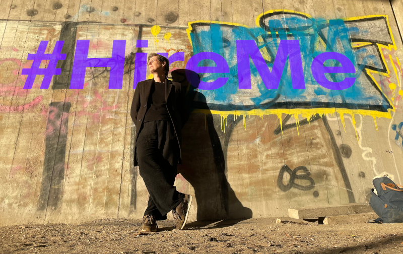

# Rachel Evans, senior software engineer

I'm Rachel Evans, a senior software engineer with just shy of 30 years' experience across a range of languages, architectures, paradigms, and business sectors — and I'm available for work.

## Code

If you're here looking for examples of what I do, then you're _sort of_ in the right place. However, over the last 30 years or so, almost all of my work has been for [my employers](https://rachelevans.org/cv), and is therefore private. But hey, look at [BBC iPlayer](https://www.bbc.co.uk/iplayer/) or [Zendesk Guide](https://zendesk.com/guide) to get an idea of what I have been making.

With that said:

- https://git.sr.ht/~rvedotrc/
- https://github.com/rvedotrc?tab=repositories
- https://github.com/orgs/blaahaj/repositories
- https://codeberg.org/rvedotrc
- https://codeberg.org/blaahaj?tab=repositories
- https://codeberg.org/teefs

## You might also be interested in

- [my profile on LinkedIn](https://www.linkedin.com/in/rvedotrc/)
- [my CV in English](https://rachelevans.org/cv/en-gb/)
- [my CV in Danish](https://rachelevans.org/cv/da-dk/)
