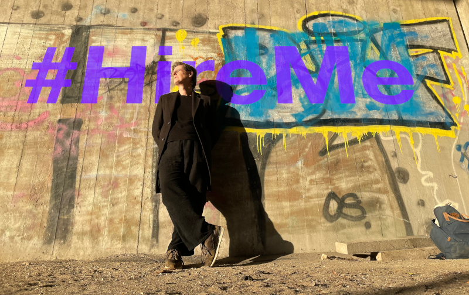

# Rachel Evans, senior software engineer

I'm Rachel Evans, a senior software engineer with just shy of 30 years' experience across a range of languages, architectures, paradigms, and business sectors — and I'm available for work.

- [my profile on LinkedIn](https://www.linkedin.com/in/rvedotrc/)
- [my CV in English](https://rachelevans.org/cv/en-gb/)
- [my CV in Danish](https://rachelevans.org/cv/da-dk/)

Almost all of my work has been for my employers, and is therefore private; so all I can show you is "hobby" code that's not particularly representative of my professional work.  At the moment it's somewhat scattered across several accounts:

- https://git.sr.ht/~rvedotrc/
- https://github.com/rvedotrc?tab=repositories
- https://github.com/orgs/blaahaj/repositories
- https://codeberg.org/rvedotrc
- https://codeberg.org/blaahaj?tab=repositories
- https://codeberg.org/teefs

